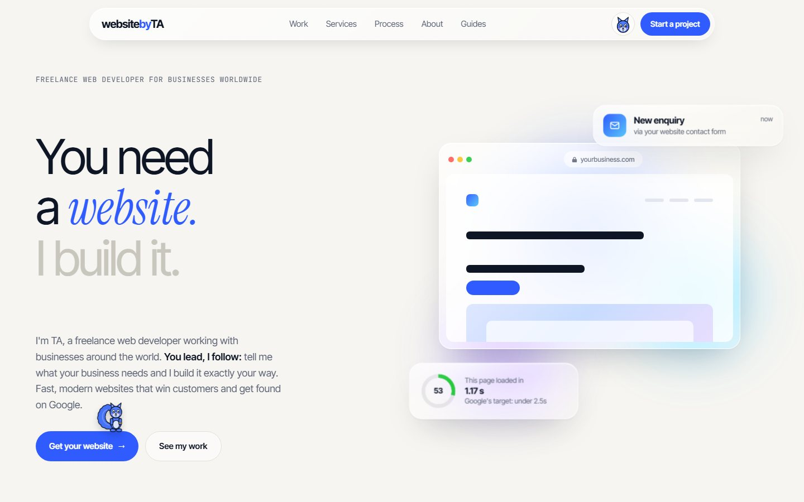
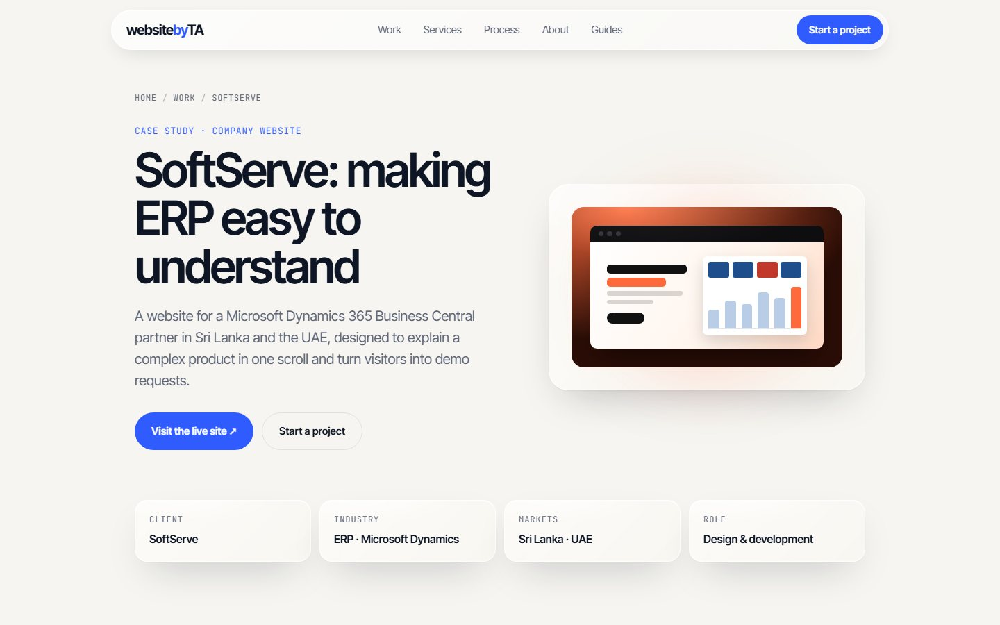
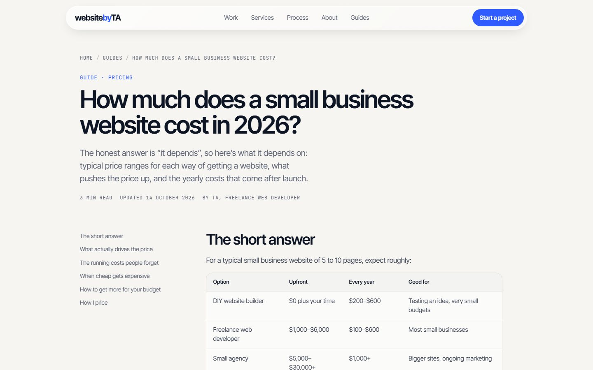
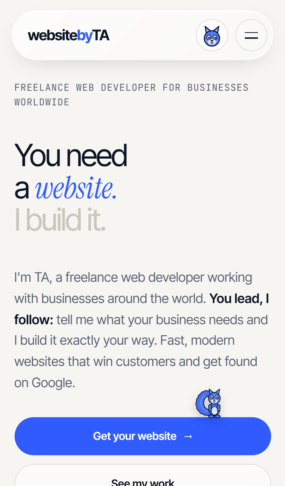

# Website by TA

**My own portfolio and lead site as a freelance web developer**

Services · case studies · country pages · guides

**[Visit the live site](https://websitebyta.vercel.app)**

> [!NOTE]
> This is a **showcase repository**: it presents the project, not its source code. The code is private.
> Website by TA was designed and built by **Tehan Athaudage** ([Website by TA](https://websitebyta.vercel.app)).

| | |
|---|---|
| **Type** | Personal product |
| **My role** | Design, development, copy and SEO |
| **Built by** | Tehan Athaudage (Tehan Gimsara), Website by TA |
| **Live** | https://websitebyta.vercel.app |

## About the project

Website by TA is where small businesses around the world find me. It is hand-built with no framework and a tiny build script, so it loads fast everywhere, and it is set up for search engines and AI assistants from the ground up.

## What I built

| | |
|---|---|
| **Fast by design** | Plain HTML, CSS and JavaScript generated by a small Node build; no framework to ship. |
| **Case studies and services** | A page for each service and each project, written for clients rather than developers. |
| **International pages** | Pages for clients in the US, UK, Australia and Canada with local currency and time-zone details. |
| **Guides** | Plain-English articles on website costs, speed, hiring a developer and more. |
| **Built for search and AI** | Structured data, sitemap, robots rules and an llms.txt summary for AI assistants. |
| **TA the squirrel** | An animated mascot with its own routine and lines. |

## Screens

<table>
<tr>
<td width="50%"> <b>Case study: SoftServe</b></td>
<td width="50%"> <b>Guide: website costs</b></td>
</tr>
<tr>
<td width="50%"> <b>Home page on a phone</b></td>
</tr>
</table>

## Tech stack

HTML · CSS · JavaScript · Node build script · Vercel

## Want something like this?

I'm Tehan Athaudage, a freelance web designer and developer from Sri Lanka working with businesses worldwide.

[Portfolio](https://websitebyta.vercel.app) · [LinkedIn](https://www.linkedin.com/in/tehan-athaudage-663102382/) · [Instagram](https://www.instagram.com/websitebyta/) · [Facebook](https://www.facebook.com/Thalric1) · [Email](mailto:websitebyta@gmail.com) · [WhatsApp](https://wa.me/94761629355)

---

© 2026 Tehan Athaudage. Showcase only: see [NOTICE.md](NOTICE.md). Client names, logos and photos belong to their owners.
